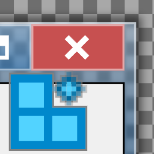

# OpenGlass GUI icon

The application icon combines a blurred glass window with three rectangular registry tiles arranged in an L and a sparkle. The background checkerboard is part of the artwork, not an indication of transparency.

## Sources and licenses

See [OpenGlass.NOTICE.txt](OpenGlass.NOTICE.txt) for complete source credits and modifications, and [AeroShotCRE.LICENSE.txt](AeroShotCRE.LICENSE.txt) for the full AeroShotCRE license. Retain both files alongside standalone icon assets and derivatives.

## Files and appearance

- [`OpenGlass.svg`](OpenGlass.svg) is the editable 256×256 SVG source.
- [`OpenGlass.png`](OpenGlass.png) is the 256×256 RGBA PNG rendered from it.
- [`OpenGlass.ico`](OpenGlass.ico) contains 16, 24, 32, 48, 64, 72, 96, 128, and 256 pixel images stored as uncompressed 32-bit DIBs with alpha transparency.

The ICO is embedded in `OpenGlassGUI.exe` as `IDI_OPENGLASS` and used for the main window. The executable also embeds the source notice as `IDR_ICON_NOTICES` and the full AeroShotCRE GPLv3 text as `IDR_AEROSHOTCRE_LICENSE`.

When updating the artwork, ensure the SVG renderer supports filters, render the PNG at 256×256, regenerate the ICO sizes with Lanczos downsampling, and keep all three assets together.

## Previous Fluent source

[`window-apps-filled.original.svg`](window-apps-filled.original.svg) and [`FluentIcons.LICENSE.txt`](FluentIcons.LICENSE.txt) retain the source and full MIT notice for the previous icon, adapted from **Window Apps (48 Filled)** in [Microsoft Fluent UI System Icons](https://github.com/microsoft/fluentui-system-icons/blob/main/assets/Window%20Apps/SVG/ic_fluent_window_apps_48_filled.svg), Copyright (c) 2020 Microsoft Corporation. These reference files are not used to generate the current icon.
